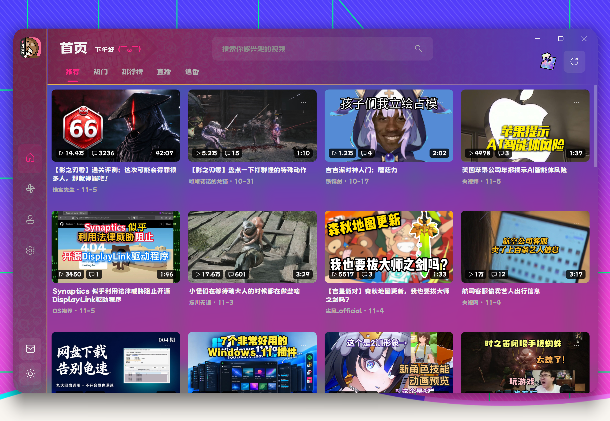

<div align="center">


# BiliTouch

**让触摸屏和触控板，成为看 B 站的自然操作方式。**

面向 Windows 平板、二合一电脑和触控板用户的哔哩哔哩第三方客户端。用横滑切页、手势调节进度与音量、长按加速和捏合全屏，把浏览与播放串起来；也保留鼠标、键盘的完整操作方式。

作者：**中三** · 公开发布版本：**0.2.15**

[下载安装](https://github.com/zhongsanZN/BiliTouch/releases/download/v0.2.15/BiliTouch-0.2.15-setup.exe) · [触控与手势](#触控与手势) · [功能改进](#功能改进) · [版本记录](docs/RELEASES.md) · [上游鸣谢](docs/ACKNOWLEDGEMENTS.md)

*WPF · .NET 10 · LibVLC · Windows 10 / 11 x64*

<br>



</div>

## 为什么叫 Touch

BiliTouch 的改进重点，是触摸屏、触控板和日常浏览的操作体验。首页翻页、信息流滚动、点播与直播控制、评论图片查看，都围绕这些输入方式持续调整。

- **触摸屏可以直接操作画面。** 横滑浏览页面，点播时横滑调整进度、左侧上下滑调节画面亮度、右侧上下滑调节音量，长按临时加速；直播也支持分区滑动调节和捏合全屏。
- **触控板有自己的交互。** 双指横滑切页，精密滚动连续浏览信息流；信息流灵敏度可单独调整，不牵动普通鼠标滚轮。播放器和直播间支持双指滚动调节、捏合全屏等操作。
- **看视频与读评论能够衔接。** 视频详情提供并排、网页两种布局。网页布局向下浏览评论时，视频停靠到右侧；评论竖图可以在评论栏内展开，减少来回打开独立窗口。

## 触控与手势

| 场景 | 操作体验 |
| :--- | :--- |
| 首页与分页区域 | 触屏横滑、触控板双指横滑切页；拖动与完成切页相衔接 |
| 信息流 | 精密滚动累积处理，连续浏览；触控板灵敏度独立设置，默认 100% |
| 点播画面 | 触屏横滑调进度，左右分区上下滑调亮度／音量，长按临时加速 |
| 点播与直播 | 支持触屏及触控板手势，包含亮度／音量调节与捏合全屏 |
| 直播侧栏 | 触控板横滑展开或收起弹幕侧栏 |
| 评论图片 | 页面内查看；并排布局的竖图在评论栏原位展开，网页布局直接内联查看 |
| 视频收藏 | 单击加入默认收藏夹或取消收藏，长按打开收藏夹选择 |

不同页面的手势按内容区划分：例如直播横滑操作侧栏，点播横滑可以调整进度。鼠标按钮、滚轮和键盘快捷键仍可使用。

## 功能改进

### 播放与直播

- 点播支持并排／网页布局、页面内视频停靠、铺满窗口和全屏，停靠时按画面宽度缩小弹幕。
- 分 P 与合集分层展示，支持合集收起与订阅；详情页整合 UP 主信息、评论和图片查看。
- 独立直播间提供画面弹幕、聊天侧栏、醒目留言、清晰度选择、重连与开播／下播状态，并适配触屏和触控板操作。
- 保留 LibVLC 播放、DASH 音视频、最高 4K、HEVC、Hi-Res／杜比音轨、倍速与听视频等播放能力。
- **实验性画质增强**位于设置 → 播放。启用后显示控制栏开关，按显卡请求厂商超分或视频处理器缩放，并显示实际驱动状态；可选 SDR 转 HDR。多显卡支持识别与应用偏好选择，实际设备分配仍受 Windows 和驱动限制。

### 动态、评论与个人内容

- 综合动态流支持视频、图文、纯文字和转发等内容，补充正文、图片、附加卡片与评论展示。
- 关注列表自动分页加载，首批内容先显示；提供更新与未读标记，无需靠不断向下滚动才继续获取关注 UP 主。
- 消息包括私信、回复与 @、收到的喜欢及新增粉丝，支持分类浏览与分页。
- 我的页面整合个人主页、历史、收藏、稍后再看和缓存；搜索支持视频、直播间、番剧与用户。
- 评论与动态支持图片、富文本和装扮表情，减少信息被压成纯文本的情况。

### 界面与个性化

- 首页、动态、我的、设置使用统一页头与常驻装扮背景，切页时装扮条保持原位。
- 星引擎装扮包含原始主题美术、互动反馈及点赞／投币／收藏／分区图标。
- 影之刃零「影境」装扮使用原始水墨、宣纸、石街和剑客素材，配有游戏原版鼠标、界面图标及适合大小位置的互动图案。
- 支持字体选择、界面缩放、亮色／暗色／跟随系统、自定义主题色，以及亚克力／云母窗口材质。
- 安装器、便携版与独立更新渠道统一维护，更新从本仓库获取。

详细改动、来源与验证边界见 [本分支改动说明](docs/MODIFICATIONS.md) 和 [逐版记录](docs/RELEASES.md)。实验性功能与硬件手势仍需结合实际显卡、驱动和设备验证。

## 下载安装

前往 [GitHub 最新发行](https://github.com/zhongsanZN/BiliTouch/releases/latest) 下载，旧版本见 [版本归档](https://github.com/zhongsanZN/BiliTouch/releases)。

| 发行包 | 适合的使用方式 |
| :--- | :--- |
| **setup.exe 安装包** | 日常使用；安装器检测 .NET 10 或更高版本的桌面运行时，缺少时引导下载 |
| **portable.zip 便携包** | 解压即用，包含运行时；完整解压后运行，保留包内原生库和资源目录 |
| **source.zip 源码包** | 对应版本源码；构建步骤见下方 |

发行页的下载附件只保留 `setup.exe`；便携包与源码包可由标签自行构建，校验值与验证记录随版本留在本机归档。
应用内更新只指向 `zhongsanZN/BiliTouch`：检测到新版本后可以在程序内下载安装器、校验 SHA-256 并静默安装重启，
失败时仍保留「前往 GitHub 下载」的退路。

## 快捷键

| 按键 | 功能 |
| :---: | :--- |
| <kbd>Space</kbd> | 播放／暂停 |
| <kbd>←</kbd> <kbd>→</kbd> | 快退／快进 5 秒；按住 <kbd>Shift</kbd> 为 30 秒 |
| <kbd>↑</kbd> <kbd>↓</kbd> | 音量增减 |
| <kbd>M</kbd> | 静音 |
| <kbd>F</kbd> | 全屏 |
| <kbd>D</kbd> | 弹幕开关 |
| <kbd>L</kbd> | 点赞 |
| <kbd>U</kbd> | UP 主主页 |
| <kbd>Esc</kbd> | 逐级返回 |

## 从源码构建

需要 Windows 10+ 和 [.NET 10 SDK](https://dotnet.microsoft.com/download/dotnet/10.0)（x64）。在仓库根目录执行：

```powershell
dotnet build BiliTouch/BiliTouch.csproj -c Release
```

LibVLC 原生库由 NuGet 包自动部署。完整发布运行根目录 `发布.ps1`；编译安装器还需要 Inno Setup。GitHub Actions 持续检查应用与 WPF 回归测试工程能否构建。

## 来源与许可

BiliTouch 由中三独立维护，基于 ABing（ABING1111）的 [BiliDesk](https://github.com/ABING1111/BiliDesk) 开发，保留上游署名与 [GPL-3.0](LICENSE) 许可。上游贡献与本分支改动分别记录在 [鸣谢](docs/ACKNOWLEDGEMENTS.md)、[NOTICE](NOTICE) 和 [改动说明](docs/MODIFICATIONS.md)。字体、依赖和美术资源遵循各自的许可或权利说明。

本项目为非官方、非商业的第三方客户端，与哔哩哔哩官方无关联；平台内容权利归相应权利人所有。
