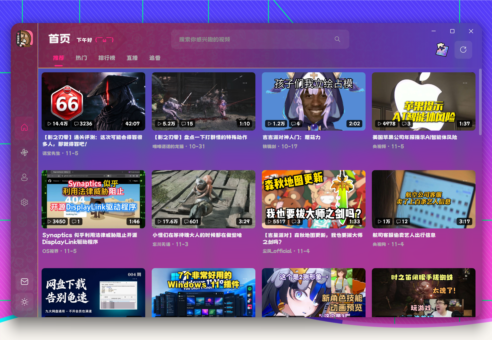

<div align="center">


# BiliTouch

**让触摸屏、Windows 平板与触控板，成为看 B 站的自然操作方式。**

面向 Windows 平板（Surface 等二合一设备，原生提供 **x64** 与 **ARM64** 双版本）和触控板用户的哔哩哔哩第三方客户端。兼顾横屏桌面模式与**竖屏「平板模式」（安卓端 B 站布局）**，用横滑切页、手势调节进度与音量、长按加速／一键三连和捏合全屏，把竖屏握持、桌面浏览与视频播放无缝串起来；同时保留鼠标、键盘的完整操作方式。

作者：**中三** · 公开发布版本：**0.3.11**

[下载安装 (x64 · Intel/AMD)](https://github.com/zhongsanZN/BiliTouch/releases/download/v0.3.11/BiliTouch-0.3.11-setup.exe) · [下载安装 (ARM64 · Surface 等 ARM 设备)](https://github.com/zhongsanZN/BiliTouch/releases/download/v0.3.11/BiliTouch-0.3.11-setup-arm64.exe) · [平板模式](#平板模式与竖屏优化) · [触控与手势](#触控与手势) · [功能改进](#功能改进) · [架构说明](docs/ARCHITECTURE.md) · [版本记录](docs/RELEASES.md) · [上游鸣谢](docs/ACKNOWLEDGEMENTS.md)

*WPF · .NET 10 · LibVLC · Windows 10 / 11 (原生 x64 & ARM64)*

<br>



</div>

## 为什么叫 Touch

BiliTouch 的改进重点，是触摸屏、触控板和日常浏览的操作体验。首页翻页、信息流滚动、点播与直播控制、评论图片查看，都围绕这些输入方式持续调整。

- **触摸屏可以直接操作画面。** 横滑浏览页面，点播时横滑调整进度、左侧上下滑调节画面亮度、右侧上下滑调节音量，长按临时加速，点赞按钮长按触发一键三连；直播也支持分区滑动调节和捏合全屏。
- **把 Windows 平板竖过来就能像安卓平板一样用。** 针对 Windows 平板竖屏握持时传统桌面多窗口与左右分栏过挤的痛点，提供专门的**「平板模式」**——自动切换底部四项导航栏、单窗口内嵌播放与安卓端 `简介 | 评论` 标签页布局，并原生支持 ARM64 版 Surface。
- **触控板有自己的交互。** 双指横滑切页，精密滚动连续浏览信息流；信息流灵敏度可单独调整，不牵动普通鼠标滚轮。播放器和直播间支持双指滚动调节、捏合全屏等操作。
- **看视频与读评论能够衔接。** 桌面端视频详情提供并排、网页两种布局，并支持**竖屏视频同屏评论优化**；网页布局向下浏览评论时视频自动停靠到右侧，评论图片直接在栏内展开，减少来回打开独立窗口。

## 平板模式与竖屏优化

针对 Surface Pro / Go 等 Windows 平板的竖屏手持场景，以及越来越多的竖屏短视频内容，BiliTouch 提供了专门的形态适配：

| 特性 | 体验说明 |
| :--- | :--- |
| **平板模式（三档切换 + Surface 识别）** | 位于「设置 → 通用 → 平板模式」，提供**关闭（默认）／自动（竖屏或窄窗自动启用）／始终开启**三档；首次检测到 Surface 设备时顶栏提供一键开启提示，竖屏下最小窗口宽度放宽至 `480 DIP` |
| **底部导航与竖屏自适应网格** | 进入平板竖屏姿态后，左侧导轨自动收起为底部四项大触控区导航栏（`首页 \| 动态 \| 我的 \| 设置`），首页卡片墙自适应为 2～3 列舒适触控间距 |
| **单窗口内嵌播放与安卓端详情页** | 平板竖屏下点播与直播直接内嵌于主窗口（单树双宿主切换，旋转屏幕不断流）；视频下方紧贴安卓端同款 **`简介 \| 评论`** 双标签栏，UP 主、标题、三连、分 P／合集与推荐统一收纳在 `简介` 页签，切到 `评论` 即刻顶格浏览 |
| **平板竖屏视频 + 半屏评论抽屉** | 平板竖屏下播放 `9:16`／`3:4` 竖屏视频时，视频舞台默认展开至约 `58%` 高度，下滑简介时平滑折叠；点击 `评论` 从底部弹出 `65%` 半屏评论抽屉，上方视频继续播放不遮挡 |
| **全站二级页面竖屏重排** | 关注动态页左侧 UP 列表转为顶部横向可滑动头像条；私信页由左右双栏转为「会话列表 ↔ 对话详情」二级全宽下钻；直播间转为上视频、下弹幕聊天单列流式布局 |
| **桌面端竖屏视频优化** | 在桌面网页布局下开启「竖屏优化」后，遇到竖屏视频时视频自动置于舞台左侧，评论区提至舞台右侧与视频并排同屏展示，告别两侧大面积黑边与翻页看评 |
| **原生 x64 & ARM64 双架构** | 每次发行同步提供 `x64`（Intel / AMD）与 `ARM64`（骁龙 Surface Pro 等 ARM 设备）原生安装包，原生加载 `libvlc/win-arm64` 与 WebView2，无转译损耗，应用内更新自动按架构匹配 |

## 触控与手势

| 场景 | 操作体验 |
| :--- | :--- |
| 首页与分页区域 | 触屏横滑、触控板双指横滑切页；拖动与完成切页相衔接 |
| 信息流 | 精密滚动累积处理，连续浏览；触控板灵敏度独立设置，默认 100% |
| 点播画面 | 触屏横滑调进度，左右分区上下滑调亮度／音量，长按临时加速 |
| 点播与直播 | 支持触屏及触控板手势，包含亮度／音量调节与捏合全屏 |
| 直播侧栏 | 触控板横滑展开或收起弹幕侧栏 |
| 评论图片 | 页面内查看；并排布局的竖图在评论栏原位展开，网页布局直接内联查看 |
| 视频收藏 | 单击加入默认收藏夹或取消收藏，长按打开收藏夹选择 |

不同页面的手势按内容区划分：例如直播横滑操作侧栏，点播横滑可以调整进度。鼠标按钮、滚轮和键盘快捷键仍可使用。

## 功能改进

### 播放与直播

- 点播支持并排／网页布局、页面内视频停靠、铺满窗口和全屏，停靠时按画面宽度缩小弹幕。
- 分 P 与合集分层展示，支持合集收起与订阅；详情页整合 UP 主信息、评论和图片查看。
- 独立直播间提供画面弹幕、聊天侧栏、醒目留言、清晰度选择、重连与开播／下播状态，并适配触屏和触控板操作。
- 保留 LibVLC 播放、DASH 音视频、最高 4K、HEVC、Hi-Res／杜比音轨、倍速与听视频等播放能力。
- 视频解码可选择显卡、自动或软件兼容模式，播放后可查看实际硬解设备；常规 8-bit 视频改用显卡颜色转换与共享纹理合成，降低高分辨率播放开销。
- **实验性画质增强**位于设置 → 播放。启用后显示控制栏开关，按显卡请求厂商超分或视频处理器缩放，并显示实际驱动状态；可选 SDR 转 HDR。多显卡支持识别与应用偏好选择，实际设备分配仍受 Windows 和驱动限制。

### 动态、评论与个人内容

- 综合动态流支持视频、图文、纯文字和转发等内容，补充正文、图片、附加卡片与评论展示。
- 关注列表自动分页加载，首批内容先显示；提供更新与未读标记，无需靠不断向下滚动才继续获取关注 UP 主。
- 消息包括私信、回复与 @、收到的喜欢及新增粉丝，支持分类浏览与分页。
- 我的页面整合个人主页、历史、收藏、稍后再看和缓存；搜索支持视频、直播间、番剧与用户。
- 评论与动态支持图片、富文本和装扮表情，减少信息被压成纯文本的情况。

### 界面与个性化

- 首页、动态、我的、设置使用统一页头与常驻装扮背景，切页时装扮条保持原位。
- 星引擎装扮包含原始主题美术、互动反馈及点赞／投币／收藏／分区图标。
- 影之刃零「影境」装扮使用原始水墨、宣纸、石街和剑客素材，配有游戏原版鼠标、界面图标及适合大小位置的互动图案。
- 支持字体选择、界面缩放、亮色／暗色／跟随系统、自定义主题色，以及亚克力／云母窗口材质。
- 安装器、便携版与独立更新渠道统一维护，更新从本仓库获取。

详细改动、来源与验证边界见 [本分支改动说明](docs/MODIFICATIONS.md) 和 [逐版记录](docs/RELEASES.md)。实验性功能与硬件手势仍需结合实际显卡、驱动和设备验证。

## 下载安装

前往 [GitHub 最新发行](https://github.com/zhongsanZN/BiliTouch/releases/latest) 下载，旧版本见 [版本归档](https://github.com/zhongsanZN/BiliTouch/releases)。

0.3.15 修复 v0.3.14 在 Surface Pro X 等触屏设备上首页上下滑动被误判为左右切页、左右滑动锁定推荐页的问题。详见 [0.3.15 更新说明](docs/release-notes/v0.3.15.md)。

| 发行包 | 适合的设备与使用方式 |
| :--- | :--- |
| **`BiliTouch-版本号-setup.exe`（Windows x64）** | Intel / AMD 64 位电脑与平板；检测 .NET 10+ 桌面运行时，缺少时自动引导下载 |
| **`BiliTouch-版本号-setup-arm64.exe`（Windows ARM64）** | 骁龙版 Surface Pro / 骁龙 X 等 ARM64 Windows 平板与笔记本；原生 ARM64 运行无转译损耗 |
| **`portable.zip` / `portable-arm64.zip` 便携包** | 解压即用，内含对应架构运行时、LibVLC 与资源目录（可由 `发布.ps1` 一键生成） |
| **`source.zip` 源码包** | 对应版本完整源码；构建步骤见下方 |

发行页的下载附件同步提供 **x64** 与 **ARM64** 两份 `setup.exe`；便携包与源码包可由标签自行构建，校验值与验证记录随版本留在本机归档。
应用内更新只指向 `zhongsanZN/BiliTouch`：检测到新版本后会自动按当前系统架构（x64 或 ARM64）匹配下载对应安装器、校验并静默安装重启，失败时仍保留「前往 GitHub 下载」的退路。

## 快捷键

| 按键 | 功能 |
| :---: | :--- |
| <kbd>Space</kbd> | 播放／暂停 |
| <kbd>←</kbd> <kbd>→</kbd> | 快退／快进 5 秒；按住 <kbd>Shift</kbd> 为 30 秒 |
| <kbd>↑</kbd> <kbd>↓</kbd> | 音量增减 |
| <kbd>M</kbd> | 静音 |
| <kbd>F</kbd> | 全屏 |
| <kbd>D</kbd> | 弹幕开关 |
| <kbd>L</kbd> | 点赞 |
| <kbd>U</kbd> | UP 主主页 |
| <kbd>Esc</kbd> | 逐级返回 |

## 从源码构建

需要 Windows 10+ 和 [.NET 10 SDK](https://dotnet.microsoft.com/download/dotnet/10.0)（x64 或 ARM64）。在仓库根目录执行：

```powershell
dotnet build BiliTouch/BiliTouch.csproj -c Release
```

LibVLC 原生库由 NuGet 包按目标架构（`win-x64` / `win-arm64`）自动部署并裁剪。完整双架构打包运行根目录 `发布.ps1`；编译安装器还需要 Inno Setup。GitHub Actions 持续检查 x64、ARM64 应用与 WPF 回归测试工程能否构建。

## 来源与许可

BiliTouch 由中三独立维护，基于 ABing（ABING1111）的 [BiliDesk](https://github.com/ABING1111/BiliDesk) 开发，保留上游署名与 [GPL-3.0](LICENSE) 许可。上游贡献与本分支改动分别记录在 [鸣谢](docs/ACKNOWLEDGEMENTS.md)、[NOTICE](NOTICE) 和 [改动说明](docs/MODIFICATIONS.md)。字体、依赖和美术资源遵循各自的许可或权利说明。

本项目为非官方、非商业的第三方客户端，与哔哩哔哩官方无关联；平台内容权利归相应权利人所有。
